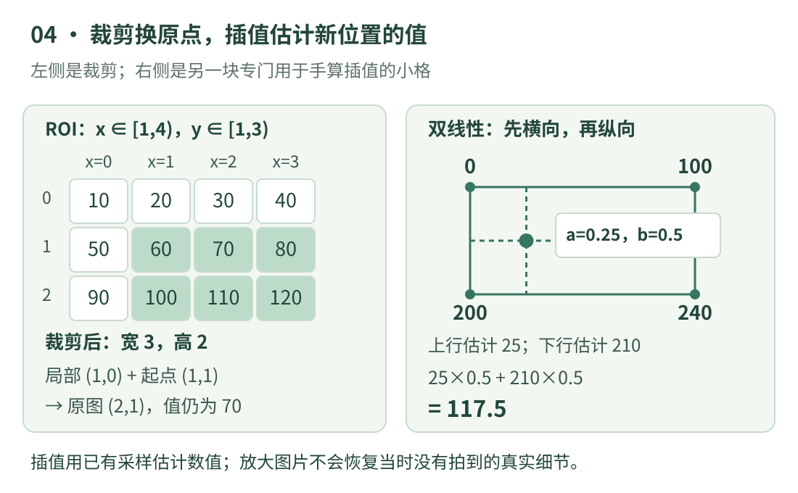

# 04 · 裁剪、缩放与插值

你把一张照片裁小，框的位置为什么突然不对了？把小图放大，为什么有时出现大方块，有时看起来更平滑？这一课围绕这两个问题，学习 **ROI、坐标换算、缩放与插值**。每一步先看数据在哪里，再考虑该怎么算。

前两课的列表和切片已经足够读本课代码。完整示例仅使用 Python 3 标准功能；OpenCV 对照按 4.13 文档核对，不要求安装或运行图像库。

## 看图：先选区域，再算区域里的位置

{ .learning-figure }

[打开大图](../assets/learning/cv-transforms.svg)

**裁剪**是从原图选出一块区域；ROI 是 Region of Interest 的缩写，意思是“感兴趣区域”。这个名字不表示程序已经理解里面的物体，只是我们决定暂时处理这里。

沿用那张宽 4、高 3 的灰度小图。选横向 `[1,4)`、纵向 `[1,3)`，就取列索引 1、2、3 和行索引 1、2。得到两行：`60、70、80` 与 `100、110、120`，区域宽 3、高 2。终点 4 和 3 是区域边界，不能再把它们当有效像素索引去取数。

裁剪不会自动改变所选像素的数值，却会改变这块图自己的坐标起点。区域左上角 60 原先在 `(1,1)`，放到区域中就成了 `(0,0)`。如果没有同时记录裁剪起点 `(x0,y0)`，就很难把区域里的检测结果画回原图。

## 一次小手算：局部坐标怎样返回原图

在裁剪图中，局部位置 `(x=1,y=0)` 的值为 70。原图位置等于“局部位置加裁剪起点”：横坐标 `1+1=2`，纵坐标 `0+1=1`，所以对应原图 `(2,1)`，仍是 70。

反过来，已知原图中一个位于 ROI 内的点 `(2,1)`，减去起点 `(1,1)`，得到局部 `(1,0)`。加减方向不必硬背：先问“原图的起点离这块区域有多远”，再用一个已知点检查。左上角这个点最方便，因为局部坐标必为 `(0,0)`。

如果一个点根本不在裁剪区域内，减去起点得到的数字也许是负数或超过局部宽高。这不是“换算失败”，而是点不属于这块图，要按任务决定忽略、截断还是另外处理。不要悄悄把所有负数变成零，否则会把原本在区域外的点伪装成落在边界上。

## 缩放：改变像素网格，不会恢复没拍到的信息

**缩放**改变输出图像的宽高。宽 4、高 3 缩成宽 8、高 6，横纵缩放系数都是 2；若缩成宽 8、高 3，横向为 2、纵向为 1，物体会被横向拉宽。需要保持形状时，应保持长宽比，或者等比例缩放后补边，并记录补边量。

放大后出现更多输出位置，必须规定这些新位置的数值从哪里来。这叫**重采样**；“插值”是估计非整数位置数值的一类方法。它使用已有信息生成估计，不会凭空增加镜头当时没有采集到的真实细节。

**最近邻插值**选最近的一个已知采样值，像把附近小格的颜色直接搬过来；边界较硬，适合某些离散标签图，避免把类别编号混合成不存在的类别。**双线性插值**在二维上结合周围四个值，通常使连续灰度或颜色过渡更平滑。哪一种更合适取决于数据含义，不能因为“看着平滑”就用同样方法缩放类别编号。

缩小时还要防止细条纹变成假纹理，这叫混叠。仅知道“双线性会平滑”不足以保证缩小质量。OpenCV 提供面积相关等重采样选项；正式处理应根据缩放方向和任务评估，而不是给所有输入固定套一个插值名字。[OpenCV 4.13 几何图像变换](https://docs.opencv.org/4.13.0/da/d54/group__imgproc__transform.html)

## 双线性插值：先横向混合，再纵向混合

单独看一个 2 × 2 灰度格子。左上是 0、右上是 100，左下是 200、右下是 240。我们约定四个采样点位于 `(0,0)、(1,0)、(0,1)、(1,1)`，要估计它们中间位置 `(x=0.25,y=0.5)` 的数值。

先沿上面一行从左向右走四分之一：`0 × 0.75 + 100 × 0.25 = 25`。再沿下面一行同样走四分之一：`200 × 0.75 + 240 × 0.25 = 210`。最后沿纵向走到两行中间：`25 × 0.5 + 210 × 0.5 = 117.5`。

把这三步压成一个式子，就是：

\[
I(a,b)=(1-b)((1-a)I_{00}+aI_{10})
       +b((1-a)I_{01}+aI_{11})
\]

`a` 是横向走过的比例，`b` 是纵向走过的比例，二者在本课格子内都属于 0～1；`I00、I10、I01、I11` 分别表示左上、右上、左下、右下的数。字母只是把刚才的四个数换成名字，不需要因为出现公式就换一种思维方式。

本例四个权重分别为 0.375、0.125、0.375、0.125，都是非负数且相加为 1。因此结果在四角最小值 0 与最大值 240 之间；若程序算出 500，可先检查权重或坐标。这是本格内部双线性估计的检查方法，不能扩大成“所有插值方法都绝不会超出原值范围”。

## 完整示例：裁剪与插值分别验证

```python title="裁剪与插值 · 标准库独立教学示例"
image = [
    [10, 20, 30, 40],
    [50, 60, 70, 80],
    [90, 100, 110, 120],
]

# 裁剪采用左上包含、右下不包含的整数索引范围。
x0, y0 = 1, 1
x1, y1 = 4, 3
roi = [row[x0:x1] for row in image[y0:y1]]
print("裁剪结果：", roi)
print(f"裁剪尺寸：宽 {len(roi[0])}，高 {len(roi)}")

# 局部坐标加上裁剪起点，返回原图坐标。
local_x, local_y = 1, 0
global_x = local_x + x0
global_y = local_y + y0
print(f"局部 (1, 0) 对应原图 ({global_x}, {global_y})")
print("对应灰度：", image[global_y][global_x])

# 这是另一块专门用于手算插值的小格，不是上面 ROI 的内容。
patch = [
    [0.0, 100.0],
    [200.0, 240.0],
]
a = 0.25       # 左边到右边走过的比例。
b = 0.5        # 上边到下边走过的比例。

# 先在上下两行分别做一次一维线性混合。
top = (1 - a) * patch[0][0] + a * patch[0][1]
bottom = (1 - a) * patch[1][0] + a * patch[1][1]
# 再把两行的结果沿纵向混合。
result = (1 - b) * top + b * bottom
print(f"上面一行的估计：{top:.1f}")
print(f"下面一行的估计：{bottom:.1f}")
print(f"双线性插值结果：{result:.1f}")
```

预期输出：

```text
裁剪结果： [[60, 70, 80], [100, 110, 120]]
裁剪尺寸：宽 3，高 2
局部 (1, 0) 对应原图 (2, 1)
对应灰度： 70
上面一行的估计：25.0
下面一行的估计：210.0
双线性插值结果：117.5
```

先确认裁剪尺寸，再确认坐标加法，最后才看插值结果。三步互相独立：ROI 的数值没有进入 `patch`，因此不要把 117.5 解释为原图某个像素的值。本例将裁剪和插值分开演示，是为了让每个计算只有一套明确输入。

## 阅读真实缩放代码时的三个约定

下面是 OpenCV **阅读片段**，前提为 `image` 是有效数组、调用方已导入 `cv`。`resize` 的尺寸参数 `(8, 6)` 按**宽、高**传入，而 NumPy `shape` 通常先高后宽。这种顺序差别很常见，写代码前把名字写全可以减少错误。

```python title="OpenCV 裁剪与缩放 · 阅读片段，未在本站运行"
# 数组切片先行后列；此类基本切片通常与原数组共享数据。
roi = image[1:3, 1:4]

# dsize=(宽, 高)；插值方法通过关键字参数明确给出。
large = cv.resize(image, (8, 6), interpolation=cv.INTER_LINEAR)
```

第二个约定是**坐标表示**。若框用图像边界坐标和半开区间表示，本例整图按两倍缩放时，框 `[1,1,4,3)` 的边界可直接变为 `[2,2,8,6)`；这里 4、3 是右下边界，不是有效像素索引。若记录的是整数采样点的中心索引，则对应关系还取决于缩放算法的采样约定，不能不加说明地直接乘系数。某些线性缩放按半像素中心关系映射源位置，例如 `源坐标 = (输出索引 + 0.5) / 缩放系数 - 0.5`；这也解释了为什么只知道系数还不足以逐像素复现库结果。

第三个约定是**边界与取整**。映射位置可能落在边缘之外，库要决定怎样延伸或限制；浮点估计写回 8 位图还涉及取整。本课只计算一个位于四角之间的浮点位置，没有复刻完整 `resize` 的坐标映射、边界策略和整数实现。因此可以用来理解双线性原理，不能声称所有输出都与某库逐位一致。

## 动手练习：用中点检查插值权重

<div class="practice-card" markdown="1">

<p class="practice-kicker">练习 04 · 先预测再修改两个比例</p>
<p class="practice-title">把插值点移到正中间与右上角</p>

保持 `patch` 不变。第一次把 `a、b` 都改成 0.5，第二次改成 `a=1、b=0`。分别手算结果，并解释为什么第二次应该正好等于一个原始采样值。

??? tip "先看提示"

    中点处，四个权重各为四分之一。右上角处，上面一行只保留右侧值，纵向又只保留上面一行。

??? example "展开参考答案"

    正中间得到 `(0+100+200+240)/4 = 135.0`。右上角得到 100.0，正好等于 `patch[0][1]`。

    这两组点都在本课允许的 `a、b ∈ [0,1]` 范围内。如果把比例写成 2，本课“位于四角之间”的前提就不成立，不能继续用前面的取值范围保证来判断。

</div>

[返回视觉学习路线](index.md) · [上一课：03 · 颜色、灰度与数值范围](color.md) · [下一课：05 · 滤波与边缘 →](filtering.md)
